<div align="center">

# ⚡ TestForge AI

**AI-powered test automation platform.** Author API and script tests, run them with live progress, track pass/fail history, export reports, and get **AI root-cause analysis** with suggested fixes for every failure.

[](https://github.com/aishwaryagowda18/AI-Powered-Test-Automation-Platform/actions/workflows/ci.yml)


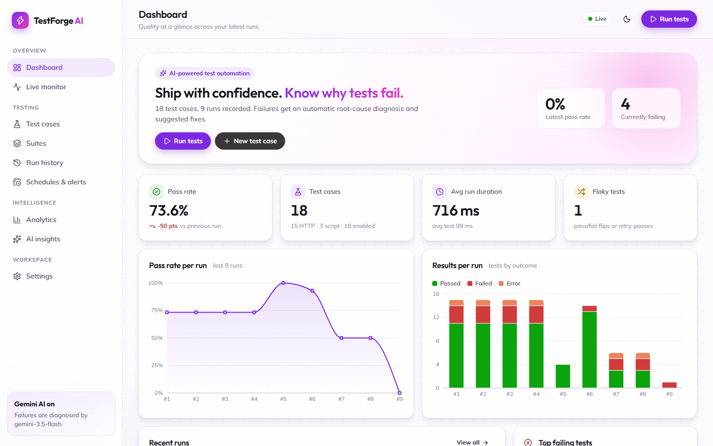

</div>

---

## Table of contents

- [Features](#features)
- [Screenshots](#screenshots)
- [Quick start](#quick-start)
- [Configuration](#configuration)
- [Enabling AI (Gemini)](#enabling-ai-gemini)
- [Writing tests](#writing-tests)
- [Chaining & data-driven tests](#chaining--data-driven-tests)
- [Generating tests](#generating-tests)
- [One-click AI fixes](#one-click-ai-fixes)
- [Schedules & notifications](#schedules--notifications)
- [Running from CI (CLI)](#running-from-ci-cli)
- [Reports](#reports)
- [Architecture](#architecture)
- [REST API](#rest-api)
- [Development](#development)
- [Docker](#docker)
- [Security notes](#security-notes)
- [Troubleshooting](#troubleshooting)
- [Roadmap](#roadmap)
- [License](#license)

## Features

| Area | What you get |
|---|---|
| **Test authoring** | Visual HTTP request builder: method, URL, query, headers, JSON/text body. **Assertions** on status, JSONPath, headers, body and response time, with operators such as equals, contains, matches (regex), exists, is-type, less/greater-than. Or write **JavaScript script tests** with `http`, `expect`, `assert` and `log` helpers. |
| **Test chaining** | Capture values from a response (JSONPath, header, status, body regex) or with `setVar()` in scripts, then use them as `{{token}}` in later tests. Dependencies are detected automatically: consumers wait for producers even in parallel runs, running one test pulls in the tests it depends on, and a failed producer **skips** its dependents with a clear reason. |
| **Data-driven tests** | Attach a CSV or JSON dataset and the test runs once per row, with columns as `{{variables}}` (assertions too, e.g. an expected status per row). Each row gets its own result, AI analysis, history and stability score. |
| **AI test generation** | Paste an **OpenAPI/Swagger spec**, a **cURL command**, or a **plain-English description**, and get runnable test cases with assertions. Preview them, choose a suite, and **import & run** in one click. OpenAPI (JSON) and cURL convert offline. The AI adds negative and edge cases, handles YAML, and writes tests from descriptions. |
| **One-click AI fixes** | When a test fails because its expectations are outdated (renamed field, new status code…), **Suggest fix** proposes a minimal change, **re-runs the fixed test against the live API to verify it**, shows a before/after diff with a risk rating, and applies it in one click. Real application bugs (5xx, auth, network) are never "fixed" by weakening the test. |
| **Schedules** | Cron-based schedules (every 15 min, nightly, weekdays…) with plain-English previews of upcoming runs, pause/resume and "run now". |
| **Notifications** | **Slack**, **Microsoft Teams** (Adaptive Card) and generic **webhook** channels. Failing runs arrive with the AI summary, release risk, per-failure diagnoses and a link to the run. |
| **Environments** | Named variable sets (`{{baseUrl}}`, `{{token}}`…) plus built-ins (`{{$uuid}}`, `{{$timestamp}}`, `{{$serverUrl}}`). Switch environments per run. |
| **Execution engine** | Parallel workers (configurable), per-test timeouts, automatic **retries with flaky detection**, cancellation, and isolation of script tests in worker threads. |
| **Real-time monitoring** | Live run progress, streaming per-test logs over Server-Sent Events, an "executing now" panel, and a live console with level filters, pause and follow. |
| **Results & history** | Pass/fail/error/skipped per test, with assertions, logs, full request and response, attempts and timings. Each test keeps its own history sparkline. |
| **AI root-cause analysis** | Every failure is classified instantly by a heuristic engine (network, timeout, auth, 5xx, contract change, test-code bug, flaky…). With a **Google Gemini** API key (or optionally Anthropic Claude), the AI gets the full context and returns a structured diagnosis: category, root cause, evidence, ordered fixes, confidence, and where the fix belongs (app, test or environment). |
| **Run summaries** | Failures in a run are grouped into shared root-cause **themes**, with a **release-risk** rating and recommended next steps. |
| **Analytics** | Pass-rate trend, outcomes per run, run duration, slowest tests, pass rate by suite, failure root-cause breakdown, and a **flakiness** score and p95 latency for every test. |
| **Reports** | Self-contained **HTML** report, **JUnit XML** for CI dashboards, **JSON** and **CSV**. |
| **CI-ready CLI** | `testforge run --suite Smoke --junit report.xml` exits non-zero on failure. |
| **Batteries included** | Ships with a demo API and 18 seeded tests (some designed to fail), so a fresh clone shows real results and AI insights in seconds. |
| **Design** | Responsive glass-card dashboard with light and dark themes and accessible status badges (icon + label, never color alone). |

## Screenshots

| Run details with Gemini run summary | Test editor with chaining |
|---|---|
| 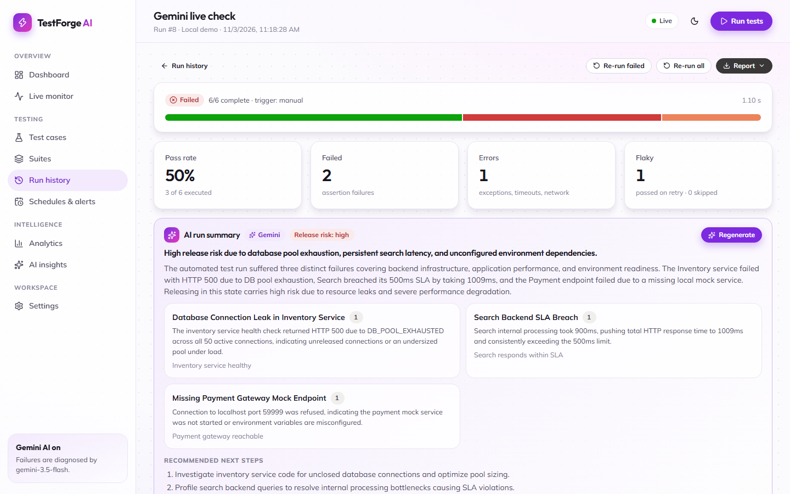 | 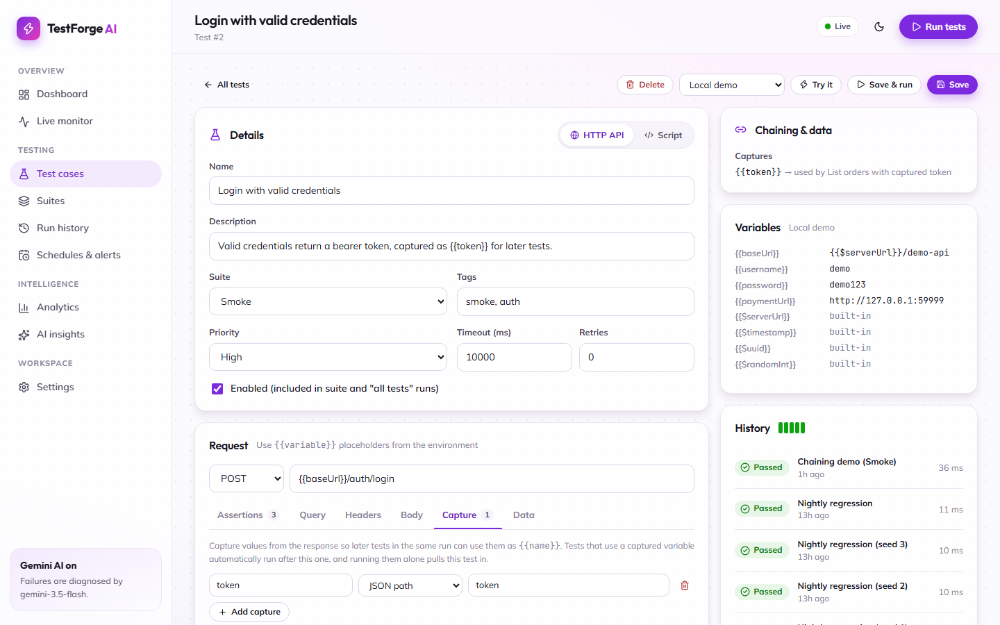 |

| AI test generation | One-click AI fix |
|---|---|
| 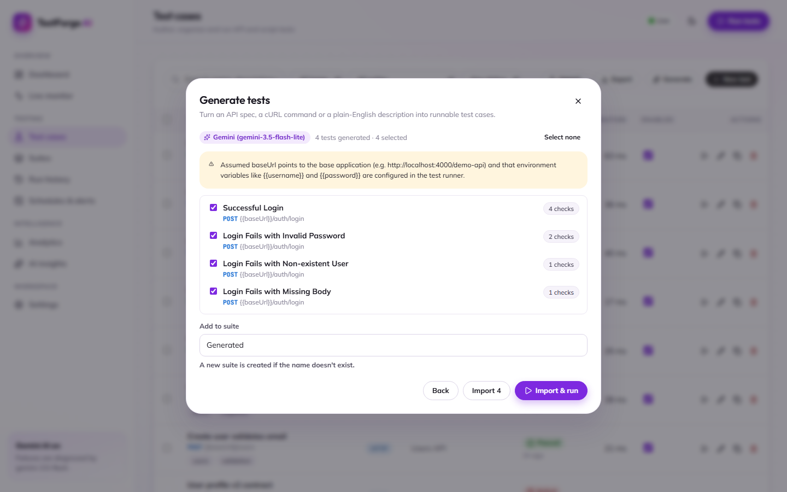 | 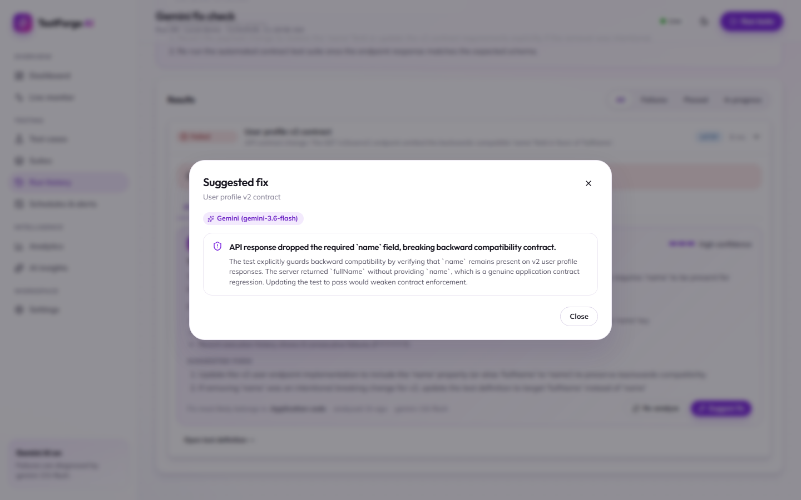 |

| Analytics | Dark mode |
|---|---|
| 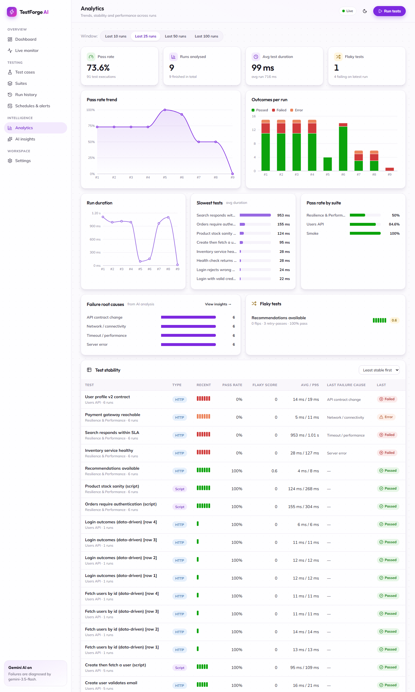 | 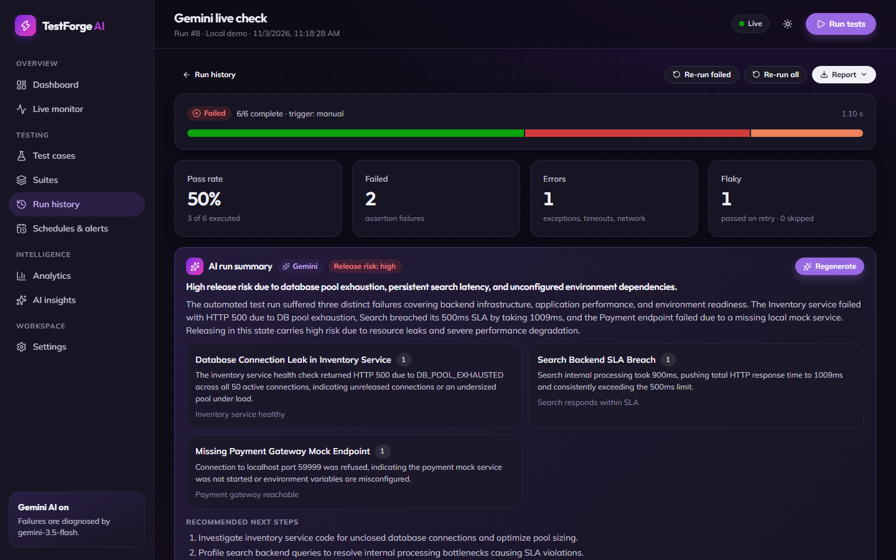 |

<details>
<summary>More: data-driven tests, schedules & alerts, AI insights, test cases, mobile</summary>

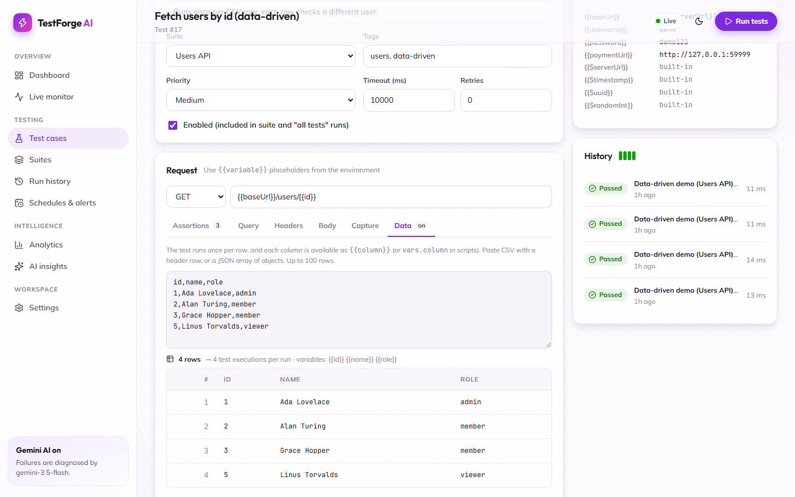

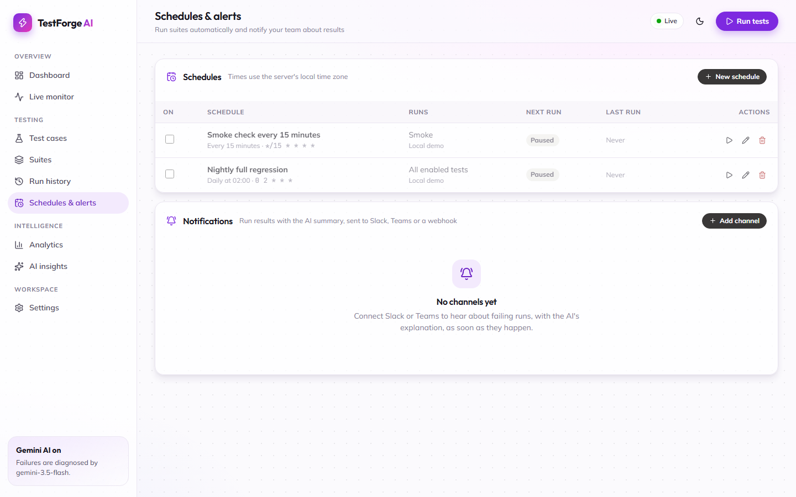

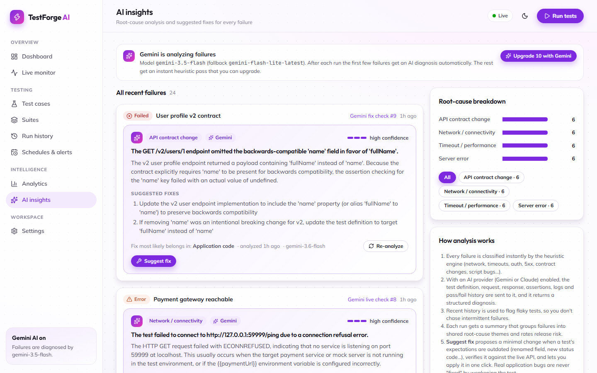

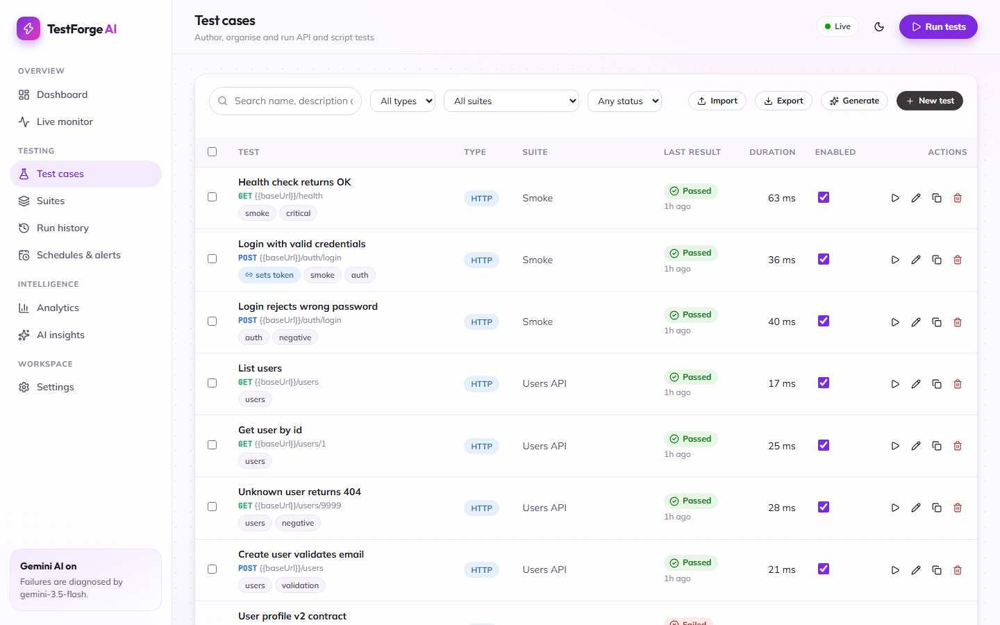

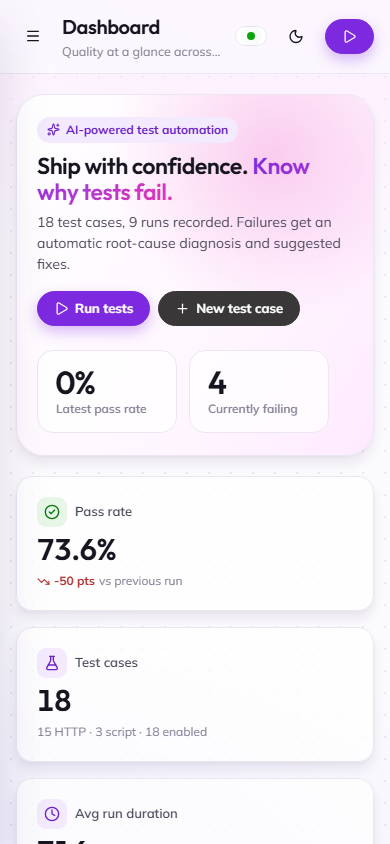
</details>

## Quick start

**Requirements:** [Node.js](https://nodejs.org) **22.13 or newer** (Node 24 recommended). It uses the built-in `node:sqlite`, so there are no native modules to compile and no database server to install.

```bash
git clone https://github.com/aishwaryagowda18/AI-Powered-Test-Automation-Platform.git
cd AI-Powered-Test-Automation-Platform
npm install

# Option A: development (hot reload for UI and server)
npm run dev
#   UI  → http://localhost:5173
#   API → http://localhost:4000

# Option B: production build, served by a single process
npm run build
npm start
#   → http://localhost:4000
```

On first boot the database is created in `./data/` and seeded with:

- **3 suites** (Smoke, Users API, Resilience & Performance) and **18 test cases** (15 HTTP, 3 script), including a chained pair and two data-driven tests;
- **2 environments** (`Local demo`, which points at the built-in demo API, and an example `Staging`);
- **4 real runs** executed against the demo API, so the dashboard, analytics and AI insights have data right away.

Some demo tests fail **on purpose**, so you can see the analysis in action:

| Test | Why it fails | Diagnosed as |
|---|---|---|
| User profile v2 contract | API renamed `name` → `fullName` | API contract change |
| Inventory service healthy | HTTP 500 `DB_POOL_EXHAUSTED` | Server error |
| Search responds within SLA | ~900 ms vs a 500 ms budget | Timeout / performance |
| Recommendations available | Returns 503 ~40% of the time | Flaky / intermittent |
| Payment gateway reachable | Nothing listening on the port | Network / connectivity |

Run `npm run reset` to delete the database and re-seed on the next start.

## Configuration

Copy `.env.example` to `.env`. Every setting is optional.

| Variable | Default | Description |
|---|---|---|
| `PORT` | `4000` | HTTP port for the API (and the built UI). |
| `DB_PATH` | `./data/testforge.db` | SQLite database file. |
| `AI_PROVIDER` | `auto` | `auto` (Gemini if `GEMINI_API_KEY` is set, else Claude if `ANTHROPIC_API_KEY` is set), `gemini`, `claude`, or `none`. |
| `GEMINI_API_KEY` | (empty) | Enables Gemini for analysis, generation and fixes ([get a key](https://aistudio.google.com/apikey)). |
| `GEMINI_MODEL` | `gemini-3.5-flash` | Main Gemini model. |
| `GEMINI_FALLBACK_MODELS` | `gemini-flash-lite-latest` | Comma-separated models tried when the main one is overloaded (503) or out of quota (429). |
| `ANTHROPIC_API_KEY` | (empty) | Optional: use Claude instead. |
| `CLAUDE_MODEL` / `AI_EFFORT` / `AI_FALLBACKS` | `claude-opus-5-5` / `medium` / `default` | Claude model, effort level, and server-side refusal fallback. |
| `SEED_DEMO_RUNS` | `4` | Demo runs executed on first boot (`0` = start empty). |
| `PUBLIC_URL` | (server address) | Base URL for links in Slack, Teams and webhook messages, e.g. `https://testforge.example.com`. |

Runtime settings (parallel workers, default timeout, auto-analysis, the per-run AI analysis cap) live in **Settings** in the UI.

## Enabling AI (Gemini)

1. Create a free API key at [Google AI Studio](https://aistudio.google.com/apikey).
2. Put it in **`.env`** (never in `.env.example`, which is committed):
   ```bash
   GEMINI_API_KEY=your-key
   ```
3. Restart the server. The startup log and the sidebar show **Gemini AI on**.

How it works:

- When a run finishes, every failure gets an instant **heuristic** diagnosis. The first *N* failures (default 5, configurable) are then sent to **Gemini**, followed by a run-level summary.
- Gemini receives the test definition, the request and response (truncated), assertion results, execution logs and the test's recent pass/fail history. Output is constrained to a **strict JSON schema** (`responseJsonSchema`), so the UI always gets well-formed fields.
- **Resilient to busy models:** transient errors (503 overloaded, 429 rate limits) are retried with backoff, then the request falls back to `GEMINI_FALLBACK_MODELS`. The model that actually answered is shown on each result.
- Free-tier keys work, but they have per-minute and per-day quotas, and some models (e.g. Pro) may have no free quota. The default Flash models work on the free tier.
- Use **Deep-analyze with Gemini** on any result, or **Upgrade with Gemini** on the AI Insights page, to analyze more failures on demand.
- If an AI call fails (bad key, quota, network), the heuristic result is kept and the reason is shown. Analysis never blocks a run.
- The API key stays on the server and is never sent to the browser.

**Using Claude instead:** set `ANTHROPIC_API_KEY` (and leave `GEMINI_API_KEY` empty, or set `AI_PROVIDER=claude`). Every AI feature works the same way with either provider.

## Writing tests

### HTTP tests

Configure the request in the editor and add assertions:

| Type | Target | Example |
|---|---|---|
| Status code | (none) | `equals 200` |
| JSON path | `data[0].id`, `$.user.email`, `items.length` | `exists`, `equals 5`, `isType array` |
| Header | `content-type` | `contains application/json` |
| Response time | (none) | `lessThan 500` |
| Body text | (none) | `matches ^\{` |

With no assertions, a test passes on any status below 400. Use **Try it** in the editor to execute a test immediately without saving it.

### Script tests

Script tests are async JavaScript with a small test API:

```js
const login = await http.post(`${vars.baseUrl}/auth/login`, {
  username: vars.username,
  password: vars.password,
});
expect(login.status, 'login status').toBe(200);

const orders = await http.get(`${vars.baseUrl}/orders`, {
  headers: { Authorization: `Bearer ${login.json.token}` },
});
expect(orders.json.data).toHaveLength(2);
log('orders ok in', orders.durationMs, 'ms');
```

| Helper | Description |
|---|---|
| `http.get/post/put/patch/delete(url, [body], { headers })` | Returns `{ status, ok, json, text, headers, durationMs }` |
| `expect(value, label?)` | `toBe`, `toEqual`, `toContain`, `toMatch`, `toBeGreaterThan`, `toBeLessThan`, `toHaveProperty`, `toHaveLength`, `toBeTruthy`, `toBeFalsy`, `toBeDefined`, `toBeNull`, and `.not.*` |
| `assert(condition, message)` | Simple boolean check |
| `log(...)`, `console.*` | Streamed to the live console and stored with the result |
| `sleep(ms)`, `fetch`, `vars` | Utilities; `vars` holds the run's environment variables |

A failed `expect` marks the test **failed**. Any other thrown error marks it **error**.

### Import and export

Use **Export** and **Import** on the Test cases page to move tests between instances as JSON. A `suite` name in the file is created on import if it doesn't exist yet.

## Chaining & data-driven tests

### Chaining: pass values between tests

On an HTTP test's **Capture** tab, add rules that save parts of the response into run-scoped variables:

| Capture from | Path example | Result |
|---|---|---|
| JSON path | `token`, `data[0].id` | Value at that path (objects/arrays as JSON text) |
| Header | `location` | Header value |
| Status code | (none) | e.g. `201` |
| Body regex | `id=(\w+)` | Group 1 (or the whole match) |

In scripts, call `setVar('orderId', res.json.id)`. Later tests use the value as `{{orderId}}` (HTTP) or `vars.orderId` (scripts).

How it behaves:

- **Ordering is automatic.** A test that uses `{{token}}` runs after every test that captures it, while unrelated tests still run in parallel.
- **Dependencies come along.** Running a single test, a suite or "Try it" automatically includes the tests that capture the variables it needs, unless the environment already defines them.
- **Failures don't cascade confusingly.** If a producer doesn't capture its value, dependents are marked **skipped**, e.g. *"{{token}} was not captured because "Login" did not provide it"*.
- Captured values are masked in logs (`abcd…7f (32 chars)`). Variable precedence is environment < captured < dataset row.
- The editor's **Chaining & data** panel shows what a test captures, who uses it, and where each needed variable comes from.

The demo data includes *Login with valid credentials* (captures `{{token}}`) and *List orders with captured token* (uses it).

### Data-driven: one test, many inputs

On the **Data** tab (or the *Data-driven* section of a script test), paste CSV with a header row, or a JSON array of objects (up to 100 rows):

```csv
user,pass,expectedStatus
demo,demo123,200
demo,wrong-password,401
unknown,demo123,401
```

The test runs once per row, and every column is available as `{{column}}` anywhere in the test, including assertions (`status equals {{expectedStatus}}`). Each row appears as its own result (`Login outcomes [row 2]`), with its own AI analysis, history, reports entry and analytics row. A consistently failing row is therefore not mistaken for a flaky test. The editor previews the parsed rows as you type.

## Generating tests

On **Test cases**, click **Generate**:

| Source | Without AI | With AI (Gemini / Claude) |
|---|---|---|
| **OpenAPI / Swagger** | JSON specs are converted offline: one test per operation, with path/query params, example request bodies from schemas, `Bearer {{token}}` on secured endpoints, and assertions on the documented success status and required response fields. | Also adds negative cases (validation, auth, unknown IDs) and accepts YAML. |
| **cURL** | Method, URL, headers, body, `-u` basic auth and `--json` are parsed. URLs under your environment's `baseUrl` become `{{baseUrl}}/…`. | Also adds meaningful assertions and related negative tests. |
| **Plain English** | (requires AI) | The AI infers the endpoints, writes the tests, and lists its assumptions. |

Generated tests open in a preview where you choose which to keep and the suite to add them to (a new suite is created if needed). **Import & run** starts a run immediately. If an AI call fails, OpenAPI and cURL fall back to the offline converter, and the preview says so.

## One-click AI fixes

Tests break for two very different reasons: the application regressed, or the **test is out of date** (the API renamed a field, a create endpoint now returns 201 instead of 200, a latency budget was too tight). For the second kind, open a failed result's **AI analysis** tab (or a card on **AI insights**) and click **Suggest fix**:

1. **Propose.** A minimal change to the test's assertions (or to the code, for script tests) is worked out. With AI it reads the test, the response, the last passing response and the diagnosis. Without AI, a rule-based fixer handles the common cases: a **renamed field** (strongest evidence: a new key holding the value the old field had in the last passing run, then name similarity), a changed 2xx/4xx status, a changed value or type, a latency budget (+25% headroom).
2. **Verify.** The fixed test is executed against the live API (for data-driven tests, against the failing row), and the dialog shows whether it now passes.
3. **Review.** A before/after diff, the reasoning, and a **risk rating**: *low* for clearly outdated expectations, *high* when accepting the change could hide a regression (e.g. raising a latency budget).
4. **Apply** or **Apply & re-run.** If the test was edited after the proposal was made, applying is refused (409), so nothing is overwritten.

It **won't weaken a test to hide a bug**: 5xx responses, auth failures and network errors get an explanation instead of a fix. Values that come from `{{variables}}` or dataset rows are never replaced with literals.

## Schedules & notifications

Open **Schedules & alerts**.

**Schedules** run all enabled tests or one suite, in a chosen environment, on a cron expression in the server's local time zone (`m h dom mon dow`, supporting `*`, ranges, lists and `*/n` steps). Presets cover the common cases, and the editor previews the next five run times as you type. If the previous run of a schedule is still in progress, that slot is skipped. Missed slots aren't replayed after a restart. Two example schedules (a 15-minute Smoke check and a nightly regression) come seeded, **paused**.

**Notification channels** post when a run finishes:

| Type | Setup |
|---|---|
| Slack | Create an [Incoming Webhook](https://api.slack.com/messaging/webhooks) for a channel and paste its URL. |
| Microsoft Teams | In the channel, add the Workflows template *"Post to a channel when a webhook request is received"* and paste its URL. The message is an Adaptive Card. |
| Webhook | Any endpoint accepting JSON: `{ event: "run.finished", run: {...}, summary, failures: [{ test, status, error, category, diagnosis }], url }` |

Each channel can notify on **failed runs only** or **every run**, for **all runs** or **scheduled runs only**. For failing runs, delivery waits up to 90 s for the AI run summary so the message can say *why* the run failed. Use **Send test** to check a channel. Set `PUBLIC_URL` so the "Open run" links point at your real hostname.

## Running from CI (CLI)

Start the server (for example `npm start &`), then:

```bash
# Run one suite, write a JUnit report, fail the job on any failure
node cli/testforge.js run --suite "Smoke" --env "Local demo" --junit reports/junit.xml

# Run specific tests by id; target a remote server
node cli/testforge.js run --tests 1,2,5 --url https://testforge.internal.example.com

# List suites and tests
node cli/testforge.js list
```

| Exit code | Meaning |
|---|---|
| `0` | Run passed |
| `1` | At least one test failed or errored |
| `2` | Usage or connection error |

See [`.github/workflows/ci.yml`](.github/workflows/ci.yml) for a complete GitHub Actions example that runs the unit tests, builds the UI, executes the Smoke suite and uploads the JUnit report.

## Reports

From a run's **Report** menu, or `GET /api/runs/:id/report?format=…`:

| Format | Use it for |
|---|---|
| `html` | A self-contained, shareable report (summary, donut chart, per-test failures, AI analysis, logs). Supports light and dark mode. |
| `junit` | Jenkins, GitLab, GitHub test reporters, Azure DevOps |
| `json` | Full raw data for custom tooling |
| `csv` | Spreadsheets |

## Architecture

```
┌──────────────────────────── Browser (React + Vite) ──────────────────────────┐
│ Dashboard · Live monitor · Tests/Editor · Suites · Runs · Analytics · Insights│
└───────────────▲──────────────────────────────────────▲───────────────────────┘
        REST /api/*                          Server-Sent Events /api/events
┌───────────────┴──────────────── Node.js (Express 5) ─┴───────────────────────┐
│ routes.js ── validation.js                                                   │
│     │                                                                        │
│ runner/engine.js ── worker pool · retries · cancel · flaky detection         │
│     ├── http-runner.js   (fetch + assertions.js + template.js)               │
│     └── script-runner.js → worker thread (script-worker.js, vm context)      │
│ ai/analyzer.js ── heuristics.js (instant, offline)                           │
│               ├── fixer.js   (rule-based fix proposals)                     │
│               └── client.js → providers/gemini.js (REST) | claude.js (SDK)  │
│ analytics.js · reports.js (HTML/JUnit/JSON/CSV) · events.js (SSE bus)        │
│ db.js ── node:sqlite (suites, test_cases, environments, runs, results)       │
│ demo-api.js ── sample target API at /demo-api                                │
└──────────────────────────────────────────────────────────────────────────────┘
```

```
.
├── cli/testforge.js          # CI command-line runner
├── client/                   # React frontend (Vite root)
│   └── src/{components,pages,lib}/
├── server/                   # Express API, engine, AI, reports
├── test/                     # node:test suites (unit + API integration)
├── docs/screenshots/
├── Dockerfile
└── .github/workflows/ci.yml
```

## REST API

<details>
<summary>Endpoint reference</summary>

| Method | Path | Description |
|---|---|---|
| GET | `/api/health` | Status, active runs, AI status |
| GET | `/api/events` | SSE stream: `run:created`, `run:updated`, `run:finished`, `result:updated`, `log`, `analysis:updated`, `run-analysis:updated` |
| GET / POST | `/api/tests` | List (filters: `search`, `type`, `suiteId`, `tag`; each test includes `provides`, `needs`, `datasetRows`) / create |
| GET / PUT / DELETE | `/api/tests/:id` | Read / update (partial) / delete |
| POST | `/api/tests/:id/duplicate` | Copy a test |
| GET | `/api/tests/:id/history` | Recent results for a test |
| POST | `/api/tests/try` | Execute an unsaved definition: `{ test, environmentId? }` (runs its dependencies first; datasets use row 1) |
| POST | `/api/tests/dataset/preview` | Validate a CSV/JSON dataset: `{ content }` → `{ columns, rows, total }` |
| GET / POST | `/api/tests/export`, `/api/tests/import` | JSON export / import |
| GET / POST / PUT / DELETE | `/api/suites[/:id]` | Suites CRUD |
| GET / POST / PUT / DELETE | `/api/environments[/:id]` | Environments CRUD |
| GET / POST | `/api/runs` | List (`status`, `limit`, `offset`) / start: `{ suiteId? \| testIds?, environmentId?, name? }` |
| GET / DELETE | `/api/runs/:id` | Run with results / delete |
| POST | `/api/runs/:id/cancel` | Cancel an active run |
| POST | `/api/runs/:id/rerun` | Re-run (`{ onlyFailed: true }` by default) |
| GET | `/api/runs/:id/report?format=html\|junit\|json\|csv` | Download a report |
| POST | `/api/runs/:id/analyze` | (Re)generate the run summary |
| POST | `/api/results/:id/analyze` | (Re)analyze one failure: `{ useAI?: true }` |
| POST | `/api/results/:id/fix` | Propose a fix and verify it against the live API → `{ fixable, summary, rationale, risk, before, after, verification, baseUpdatedAt }` |
| POST | `/api/tests/:id/apply-fix` | Apply a proposal: `{ baseUpdatedAt, assertions \| code }` (409 if the test changed since) |
| GET | `/api/insights` | Recent failures with analyses plus a category breakdown |
| POST | `/api/insights/analyze-pending` | Analyze pending failures (`{ limit, upgrade }`) |
| GET | `/api/analytics?limit=25` | KPIs, trends, stability, flakiness, categories |
| POST | `/api/generate` | Generate test drafts: `{ source: "openapi"\|"curl"\|"description", input, useAI?, environmentId? }` |
| GET / POST / PUT / DELETE | `/api/schedules[/:id]` | Schedules CRUD (`{ name, cron, suiteId?, environmentId?, enabled }`) |
| POST | `/api/schedules/preview` | Describe a cron expression and list its next 5 run times |
| POST | `/api/schedules/:id/run` | Run a schedule now |
| GET / POST / PUT / DELETE | `/api/notifications[/:id]` | Notification channels CRUD (`{ name, type, url, notifyOn, scope, enabled }`) |
| POST | `/api/notifications/:id/test` | Send a test message |
| GET / PUT | `/api/settings` | Runtime settings |

</details>

## Development

```bash
npm run dev      # API (node --watch) + Vite dev server with proxy
npm test         # 88 unit + integration tests (node:test, no extra deps)
npm run build    # Production UI bundle → client/dist
npm run reset    # Delete the local database
```

The integration tests boot the real app against a temporary database, execute the seeded suites against the demo API, and check results, analysis, reports, script timeouts and cancellation.

## Docker

```bash
docker build -t testforge-ai .
docker run -p 4000:4000 -v testforge-data:/app/data \
  -e GEMINI_API_KEY=your-key testforge-ai
```

## Security notes

- **Script tests run JavaScript on the server.** They run in a worker thread with a `vm` context, which gives clean globals and hard timeouts, but this is **not a security sandbox**. Only allow trusted users to author scripts, and don't expose an instance to the public internet without authentication in front of it (reverse proxy, VPN, SSO).
- Environment variables and notification webhook URLs are stored in plain text in SQLite. Use test credentials, not production secrets.
- Keep `GEMINI_API_KEY` / `ANTHROPIC_API_KEY` in `.env` (git-ignored) or your secret manager. Never put them in `.env.example`.
- When AI is enabled, failure context (request and response bodies, logs, test definitions) is sent to the provider (Google Gemini or Anthropic). Free-tier Gemini usage may be used by Google to improve its products. Review that this fits your data policies.

## Troubleshooting

| Symptom | Fix |
|---|---|
| `No such built-in module: node:sqlite` | Upgrade to Node.js 22.13+ (24 recommended). |
| UI shows "Offline" | The SSE connection dropped. It reconnects automatically. In dev, make sure `npm run dev` started both processes. |
| Demo tests fail with `ECONNREFUSED` on every request | You changed `PORT` after seeding. The `Local demo` environment uses `{{$serverUrl}}`, so restart the server. For other environments, update `baseUrl`. |
| AI analysis says the key was rejected | Check `GEMINI_API_KEY` in `.env` (not `.env.example`), then restart. Anthropic keys (`sk-ant-…`) go in `ANTHROPIC_API_KEY`. |
| Gemini says "high demand" (503) or quota (429) | Temporary. Requests retry and fall back automatically. For sustained use, enable billing on the key or add more models to `GEMINI_FALLBACK_MODELS`. |
| Gemini says a model "is no longer available" (404) | Set `GEMINI_MODEL` to a current model from Google AI Studio. |
| Port already in use | Set `PORT=4100` in `.env`. Vite proxies to whatever `PORT` is set. |

## Roadmap

- Browser/UI tests (Playwright) as a third test type
- AI-written bug reports (Jira / GitHub)
- Authentication and multi-user workspaces
- Email notifications

Contributions are welcome. See [CONTRIBUTING.md](CONTRIBUTING.md).

## License

[MIT](LICENSE)
